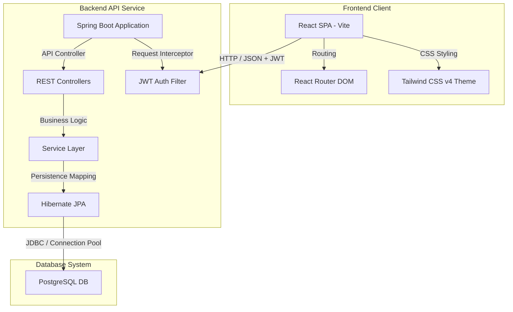
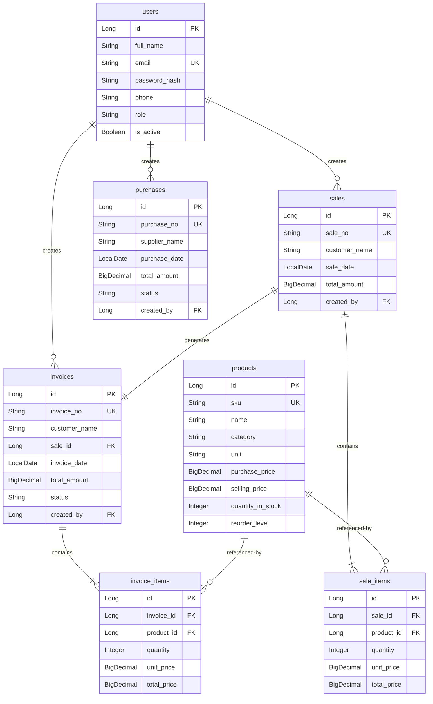
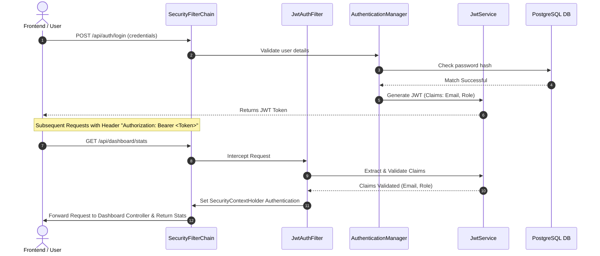

# System Architecture Specification
## LogiTrack - Inventory Management System (IMS)

This document provides a comprehensive architectural specification of the **LogiTrack Inventory Management System (IMS)**, analyzing both the frontend (React + Vite) and backend (Spring Boot + PostgreSQL) codebases.

---

## 1. System Overview & Technical Stack

LogiTrack is built on a **Three-Tier Client-Server Architecture** designed for speed, security, and scalability. It is split into two independent services: a stateless REST API backend and a single-page application (SPA) frontend.



### Core Technologies
- **Client (Frontend):** React.js, Vite, Tailwind CSS v4, React Router DOM, Material Symbols.
- **Application (Backend):** Java 21, Spring Boot 4.1.0, Spring Data JPA, Spring Security, JSON Web Tokens (JWT via `jjwt`), Lombok.
- **Database (Data Tier):** PostgreSQL 18.4 (using HikariCP connection pooling).

---

## 2. Backend Architecture (Spring Boot)

The backend is structured around the **Layered Architectural Pattern** to enforce separation of concerns, maintainability, and clean boundary interfaces.

### Package Directory Structure
```
com.example.sales.Inventory.Management.System
├── InventoryManagementSystemApplication.java  # Application Entry Point
├── auth/          # User registration & login handlers
├── config/        # Global CORS, Database seeding, and Security configuration
├── dashboard/     # Aggregates analytical statistics across other modules
├── exception/     # Global API exception mapping and validation errors
├── invoice/       # Invoices and billing items entity group
├── product/       # Inventory products and catalog logic
├── purchase/      # Stock restock purchases flow
├── sales/         # Customer sales transactions
├── security/      # JWT authentication middleware, custom UserDetails
├── user/          # User definitions, roles, and profiles
└── utill/         # Shared utilities (auditing base, JWT parser)
```

### Layered Separation of Concerns
1. **Domain Model Layer (`*Entity.java`):** Represents JPA mappings to the PostgreSQL tables. Extends `AuditableEntity` for automatic timestamps.
2. **Data Access Layer (`*Repository.java`):** Extends `JpaRepository`. Custom native SQL and HQL queries are declared using `@Query` to calculate statistics directly at the database layer (e.g. category metrics and low stock count).
3. **Business Logic Layer (`*Service.java`):** Houses business constraints, validations, and manages database transactions (`@Transactional`).
4. **Presentation Layer (`*Controller.java`):** Defines RESTful endpoints, handles status codes, and transforms domain objects into Data Transfer Objects (DTOs).

---

## 3. Database Schema & Mappings

The system utilizes PostgreSQL as its system of record. Every transactional entity extends `AuditableEntity`, inheriting the following audit tracking fields:
- `createdAt` (`timestamp`)
- `updatedAt` (`timestamp`)

### Entity Relationship Model



---

## 4. Security & JWT Validation Architecture

LogiTrack enforces stateless session security via JWTs. Authentication filters intercept incoming requests, validate tokens, and load secure context dynamically.

### Security Pipeline



- **Stateless Configuration:** Session creation is disabled (`SessionCreationPolicy.STATELESS`), forcing authorization parameters to be stored client-side.
- **CORS Configuration:** Standardized to allow API requests specifically from Vite development nodes (`http://localhost:5173`, `http://localhost:5174`), supporting cookie credentials.

---

## 5. Frontend Architecture (React)

The frontend is a single-page application built on React, bundled with Vite for near-instant rendering.

### Module Layout
```
src
├── components/
│   └── Sidebar.jsx     # Reusable layout navigation sidebar
├── pages/
│   ├── Register.jsx    # User Registration
│   ├── Login.jsx       # User Login & token generation
│   ├── Dashboard.jsx   # Metrics, category distributions, recent ledger activity
│   ├── Products.jsx    # Placeholder Products page
│   ├── SalesOrders.jsx # Placeholder Sales Orders page
│   ├── Invoices.jsx    # Placeholder Invoices page
│   ├── Purchases.jsx   # Placeholder Purchases page
│   └── Reports.jsx     # Placeholder Reports page
├── App.jsx             # React Router routing configuration
├── index.css           # Tailwind CSS import, custom variables, custom animations
└── main.jsx            # DOM Renderer entry point
```

### Styling System (Tailwind CSS v4)
LogiTrack leverages the advanced features of **Tailwind CSS v4**:
- **Design Tokens (`@theme`):** All custom branding colors (primary, surface-container, errors, and custom font weights) are centralized in `@theme` blocks inside `index.css`.
- **Custom Classes:** Premium designs are grouped into specific, reusable global classes, e.g.:
  - `.mesh-gradient-bg` (for high-end mesh login backgrounds)
  - `.bg-premium-gradient` (blue gradient accents)
  - `.glass-effect` (backdrop blurring for floating cards)

### Integration & Fallback State
When calling API services, the frontend uses native `fetch` requests with bearer authentication headers. If the Spring Boot backend server is offline or unreachable, the frontend automatically traps the execution error and initializes a local **Mock Stats Fallback** (via `loadMockStats`), notifying the user with a dynamic **Demo Mode** indicator badge in the header.

---

## 6. System Strengths & Senior Developer Analysis

### Key Strengths
1. **Modular UI Separation:** The extraction of `Sidebar.jsx` cleanly divides layout concerns from feature views, reducing duplicate JSX and maintaining identical active classes dynamically.
2. **Audit Trails out-of-the-box:** Inheritance of `AuditableEntity` enforces standard creation/update logging on all records without manual service logic overhead.
3. **Stateless Scalability:** JWT tokens keep the Spring backend completely stateless, facilitating zero-downtime rolling updates and microservice scaling.
4. **Resilient Frontend fallbacks:** Frontend can run standalone with pre-defined Mock state fallbacks, easing client demonstration and sandbox trials.

### Production-Ready Recommendations
- **Database Migration Framework:** Currently, the system uses `spring.jpa.hibernate.ddl-auto=update`. In production, this should be set to `validate` or `none`, using schema migrations tools such as **Flyway** or **Liquibase** to manage incremental changes.
- **In-Memory Testing Database:** Introduce **H2 Database** inside the test profile (`application-test.properties`) to run unit/integration tests quickly without requiring a live connection to PostgreSQL.
- **Caching Layer:** For heavy aggregation methods like `getDashboardStats`, implement a caching mechanism (e.g. Redis or Spring Cache) with standard eviction policies to optimize database read loads.
