# LogiTrack — Enterprise Inventory Management System (IMS)

[](https://openjdk.org/)
[](https://spring.io/projects/spring-boot)
[](https://react.dev/)
[](https://www.postgresql.org/)
[](https://jwt.io/)
[](https://swagger.io/)
[](https://inventory-managment-system-eta.vercel.app)
[](https://inventory-managment-system-31tb.onrender.com)
[](LICENSE)

LogiTrack is a production-grade, full-stack Inventory Management System (IMS) designed to streamline B2B workflows, automate transaction recording, and provide real-time reporting. It connects a secure, stateless Spring Boot REST API backend with a high-performance React Single Page Application (SPA) frontend.

---


## 🚀 Core Platform Features

- **Dynamic Operations Dashboard**: Visualizes live business health metrics including total product lines, low-stock notifications, monthly sales volumes, category distributions, and real-time transaction ledgers.
- **Product Catalog Management**: Supports paginated directories, column sorting, and search filters. Enforces SKU uniqueness and profit margin business rules.
- **B2B Transactions Registry**: Manages customer sales orders and supplier restock purchases with automatic stock adjustment calculations.
- **Automated Billing Engine**: Auto-generates clean, printable HTML invoices from completed sales orders, detailing subtotals, tax rates, and applied discounts.
- **Security & Authorization**: Uses stateless JWT authentication, secure BCrypt password hashing, role-based method guards (`ADMIN`, `MANAGER`, `STAFF`), and secure email-activation tokens.
- **Platform Auditing Trails**: Logs administrative actions (login attempts, stock changes, order completions) with actor details, timestamps, and client IP addresses.
- **Resilient Offline Demomode**: Automatically falls back to a mock client-side demonstration mode if the production API server becomes temporarily unreachable.

---

## 🏗 System Architecture & Flow

### Deployment Architecture

```
                       ┌────────────────────────┐
                       │      Vercel (Host)     │
                       │   React 19 SPA Client  │
                       └───────────┬────────────┘
                                   │
                           HTTPS   │  JWT Header
                           REST    │  Requests
                                   ▼
                       ┌────────────────────────┐
                       │      Render (Host)     │
                       │  Spring Boot REST API  │
                       └───────────┬────────────┘
                                   │
                                   ├────────────────────────┐
                        Spring JPA │             SMTP (587) │
                         Hibernate │                        │
                                   ▼                        ▼
                       ┌────────────────────────┐      ┌─────────┐
                       │   Neon Database Host   │      │  Gmail  │
                       │  PostgreSQL 16 DB      │      │  SMTP   │
                       └────────────────────────┘      └─────────┘
```

### Application Features & Flow

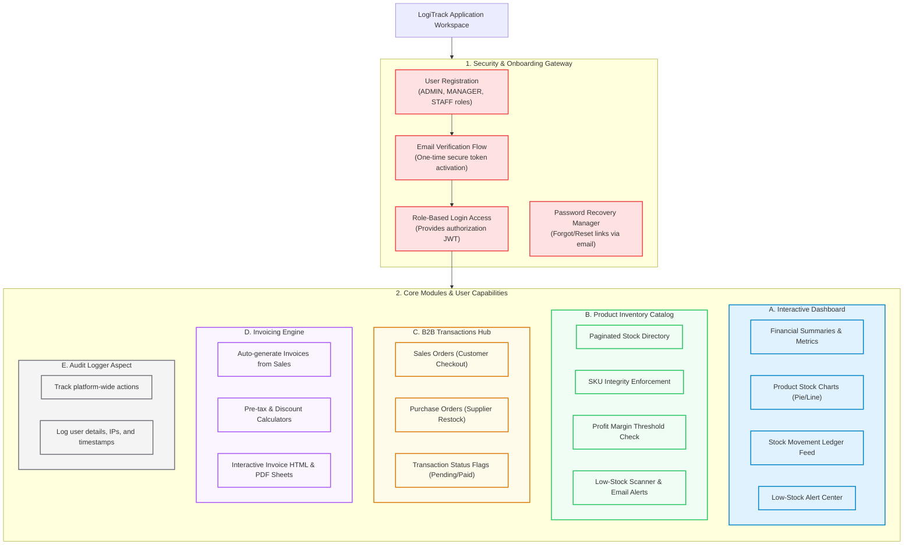

---

## 🛠 Technology Stack

### Frontend Client
* **Framework**: React 19.2.7
* **Build Tool**: Vite 8.1.1 (Rolldown Compiler)
* **CSS Framework**: Tailwind CSS v4.3.2
* **HTTP Client**: Axios 1.18.1 (Custom JWT interceptors)
* **Form & Validation**: React Hook Form 7.81.0, Zod 4.4.3
* **Charts**: Recharts 3.9.2

### Backend REST API
* **Framework**: Spring Boot 4.1.0 (starter parent)
* **Security & Auth**: Spring Security, JSON Web Tokens (`jjwt` 0.12.6)
* **ORM Engine**: Hibernate JPA (HikariCP connection pool)
* **Documentation**: Springdoc OpenAPI 2.8.8 (Swagger UI)
* **Email Client**: Spring Boot Starter Mail

### Database & Hosting
* **Database**: PostgreSQL 16 (Neon Cloud serverless instance)
* **API Hosting**: Render Web Service
* **Frontend Web Hosting**: Vercel Platform

---

## 📊 Codebase Statistics

The following statistics are calculated directly from the project source code components:

| Component Type | Count | Description |
| :--- | :--- | :--- |
| **Java Files** | 140 | Core backend classes, interfaces, and configurations |
| **Controllers** | 14 | Spring MVC REST API endpoints exposed to the frontend |
| **Services** | 20 | Business logic services and alert scanners |
| **Repositories** | 10 | Spring Data JPA database query abstractions |
| **Entities** | 15 | Relational database mapping models |
| **REST APIs** | 88 | Total exposed API paths (GET, POST, PUT, DELETE) |
| **React Components** | 15 | Reusable layout and dashboard UI widgets |
| **React Pages** | 18 | Individual application route views |
| **Database Tables** | 11 | Schema tables mapped in PostgreSQL database |

---

## 📂 Project Directory Structure

```
Inventory-Managment-System/
├── IMS_backend/                      # Spring Boot REST API
│   ├── src/main/java/com/example/sales/Inventory/Management/System/
│   │   ├── auth/                     # Authentication & DTO contracts
│   │   ├── config/                   # Security, AOP, Seeding configs
│   │   ├── dashboard/                # Statistics calculators
│   │   ├── exception/                # Global exception handling
│   │   ├── invoice/                  # Invoicing & document templates
│   │   ├── product/                  # Products & Stock entities
│   │   ├── security/                 # JWT filters & route guards
│   │   └── user/                     # Users & Roles management
│   └── pom.xml                       # Maven build descriptor
│
├── IMS_frontend/                     # React Single Page Application (SPA)
│   ├── src/
│   │   ├── api/                      # Axios client & config instances
│   │   ├── components/               # Custom UI cards, drawers, & modals
│   │   ├── pages/                    # Auth, Catalog, and Dashboard views
│   │   └── App.jsx                   # React Router route registry
│   └── package.json                  # Node package dependencies
│
├── screenshots/                      # Project UI presentation images
├── schema.sql                        # PostgreSQL table creation script
└── README.md                         # Project documentation
```

---

## ⚙️ Environment Variables Reference

Below is a reference guide for configuring the local environment variables.

| Variable Name | Required | Default Value | Description |
| :--- | :--- | :--- | :--- |
| `DB_URL` | Yes | `jdbc:postgresql://localhost:5432/IMS` | PostgreSQL JDBC connection URL |
| `DB_USERNAME` | Yes | `postgres` | Database connection login username |
| `DB_PASSWORD` | Yes | `password` | Database connection login password |
| `JWT_SECRET` | Yes | None (User defined) | 256-bit signing key for JWT signature checks |
| `MAIL_USERNAME` | No | None (Optional) | Sender Gmail account name |
| `MAIL_PASSWORD` | No | None (Optional) | Google App Password for SMTP transport |
| `AUTO_VERIFY_USERS` | No | `false` | Set to `true` to auto-activate new users without email verification steps |

---

## 💻 Local Setup & Development

### Prerequisite Checklist
1. Java 21 JDK installed and configured in system path.
2. Node.js (version 20+) installed.
3. A running local PostgreSQL instance.

---

### Step 1: Database Initialization
1. Connect to your PostgreSQL instance using `psql` or an administration GUI tool.
2. Execute the following statement to create the database:
   ```sql
   CREATE DATABASE "IMS";
   ```
3. Load the schema tables using the [schema.sql](file:///d:/Projects/Internhip-project/schema.sql) script:
   ```bash
   psql -U postgres -d IMS -f schema.sql
   ```

---

### Step 2: Start the Backend API
1. Navigate to the backend directory:
   ```bash
   cd IMS_backend
   ```
2. Create your `.env` file or export your database credentials:
   ```bash
   export DB_URL=jdbc:postgresql://localhost:5432/IMS
   export DB_USERNAME=postgres
   export DB_PASSWORD=your_password
   export JWT_SECRET=your_minimum_32_character_signing_key
   ```
3. Boot the application using the Maven wrapper:
   ```bash
   ./mvnw spring-boot:run
   ```
The backend starts on port `8080`. API documentation is accessible at `http://localhost:8080/swagger-ui.html`.

---

### Step 3: Start the Frontend Client
1. Navigate to the frontend directory:
   ```bash
   cd IMS_frontend
   ```
2. Install npm packages:
   ```bash
   npm install
   ```
3. Run the development server:
   ```bash
   npm run dev
   ```
The client runs locally at `http://localhost:5173`.

---

## 📸 Screenshots & UI Showcase

### 🏗 Features Map
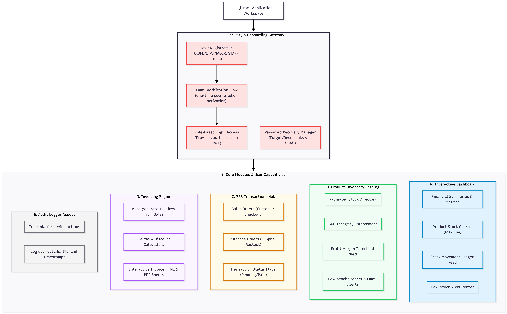

### 🔐 User Onboarding & Auth
| Login Portal | Registration Portal |
| :---: | :---: |
| 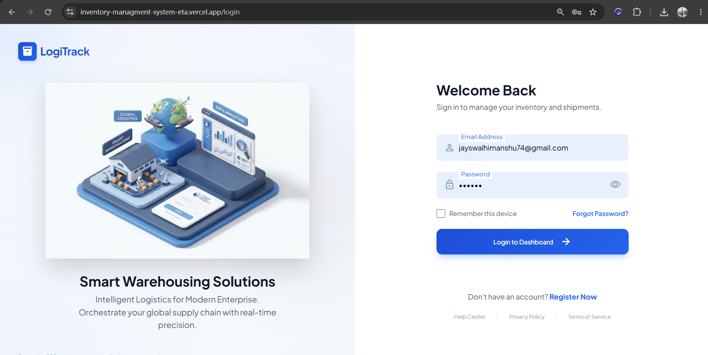 | 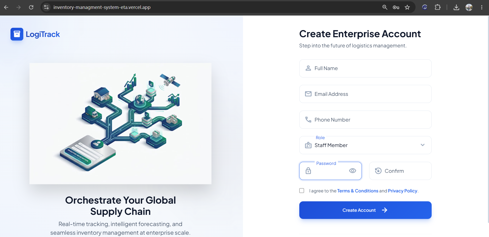 |

### 📊 Real-Time Operations Console
| Main Dashboard | Analytics & Reports |
| :---: | :---: |
| 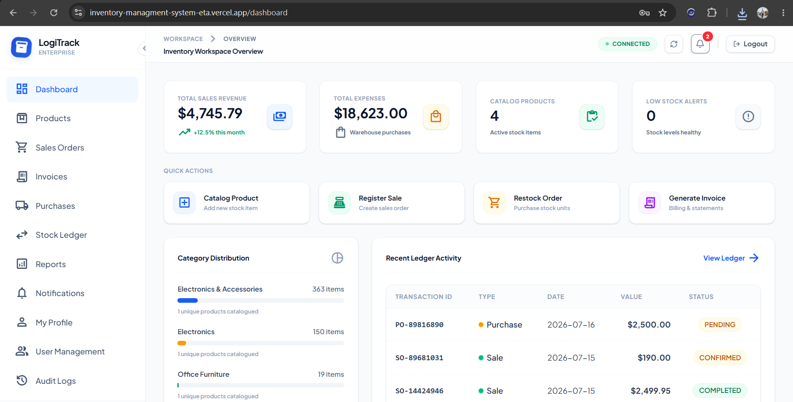 | 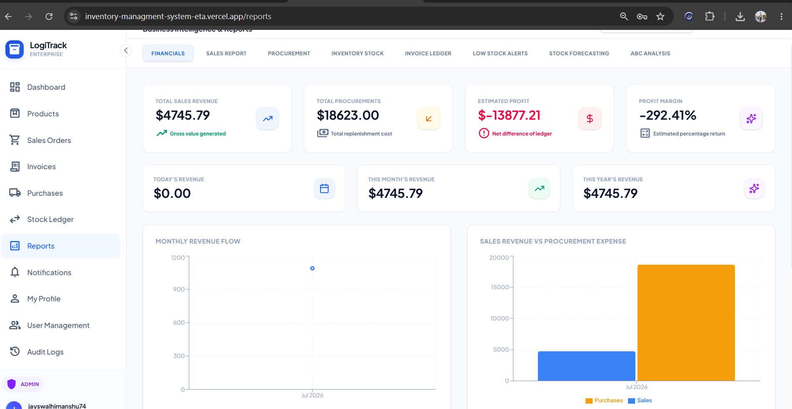 |

### 📦 Product & Inventory Catalog
| Product Inventory Directory | Stock Movement Ledger |
| :---: | :---: |
| 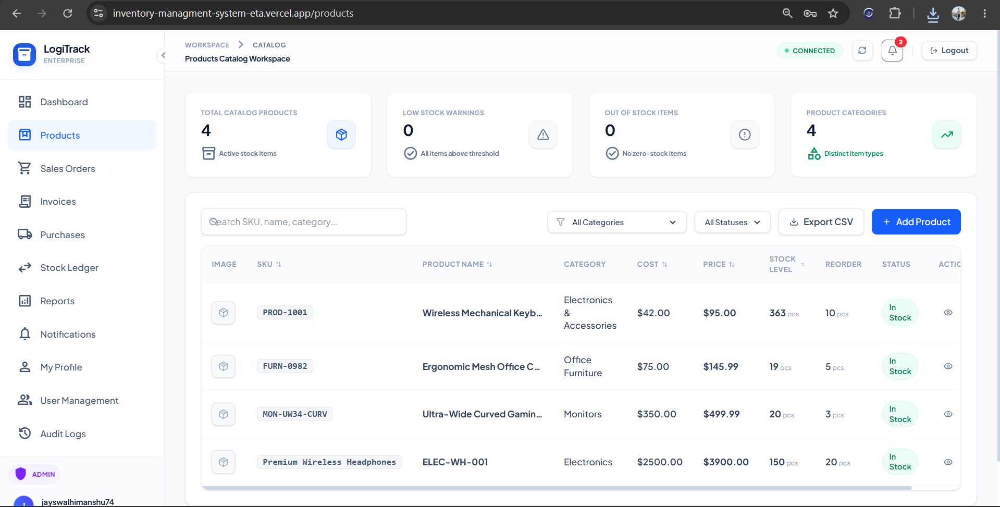 | 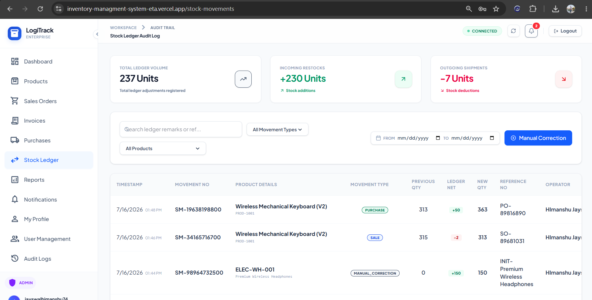 |

### 💼 Restocking & Procurement (B2B)
| Customer Sales Orders | Supplier Restock Purchases |
| :---: | :---: |
| 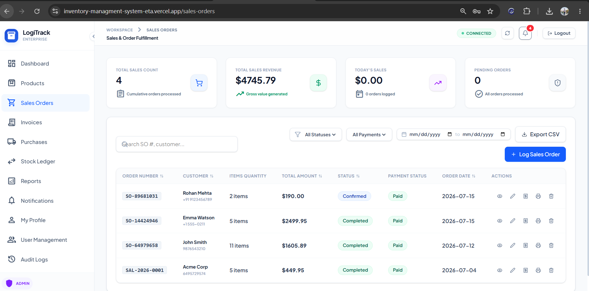 | 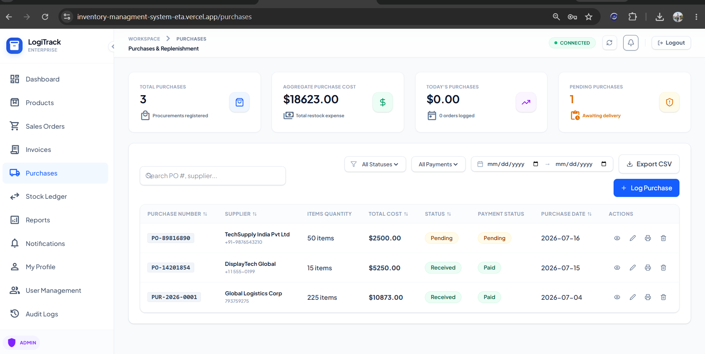 |

### 📑 Invoicing & Notifications
| Billing & Invoices List | HTML/PDF Invoice Sheet |
| :---: | :---: |
| 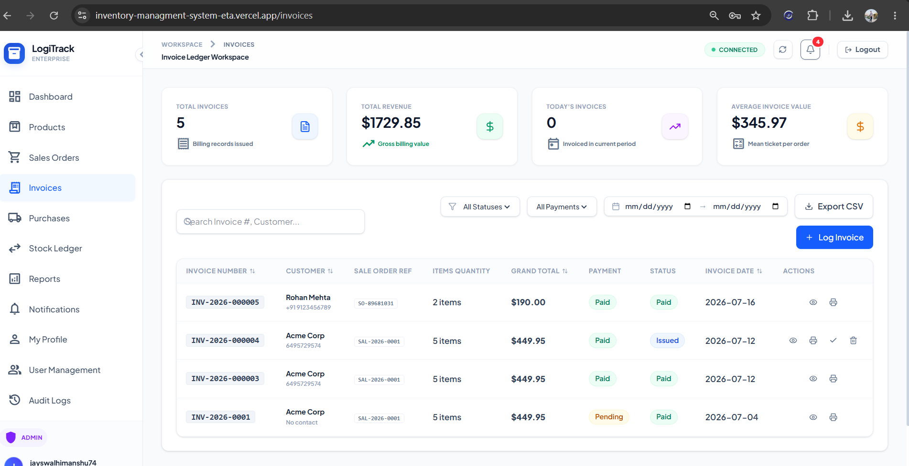 | 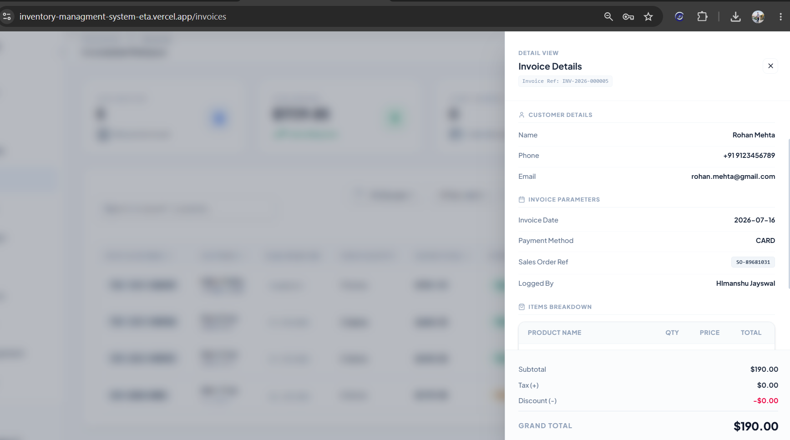 |

| Live System Banners & Notifications |
| :---: |
| 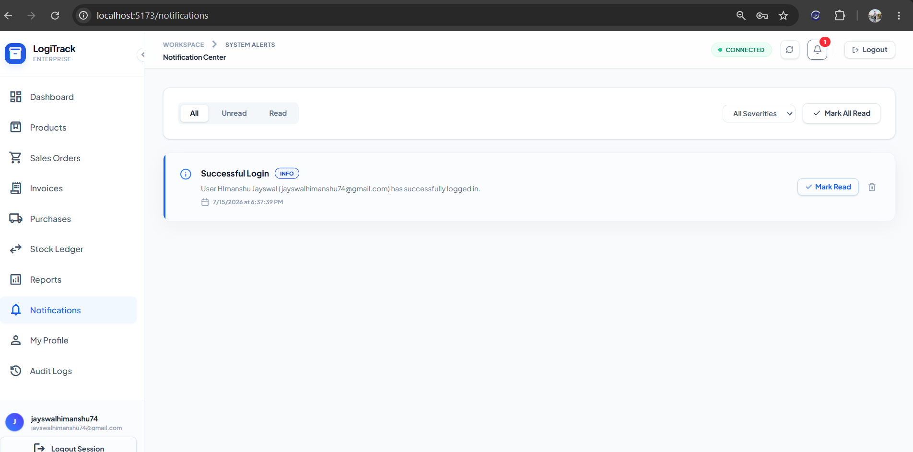 |

---

## 🛡️ Security Architecture

LogiTrack enforces security controls across every application layer:

- **Stateless Authorization**: Uses secure JSON Web Tokens (JWT) signed using a HMACS SHA-256 algorithm. The tokens are verified inside custom filters (`JwtAuthFilter.java`) before reaching endpoint controllers.
- **Credential Protection**: Uses BCrypt password encoder to hash credentials inside the authentication registry.
- **Role-Based Routing (RBAC)**: Protects critical controllers with security guards. Users must have matching credentials (`ADMIN`, `MANAGER`, `STAFF`) to access reports or modify products.
- **Double-Layer Data Verification**: Employs Zod schemas inside React Hook Form for front-end interface checking, paired with `@Valid` JSR-380 validation annotations on backend Request DTOs.
- **Two-Step Verification Flows**: Employs unique tokens (`EmailVerificationToken`, `PasswordResetToken`) to verify registration emails and reset credentials.

---

## 🚀 Cloud Deployment Configuration

### Frontend Client (Vercel)
- Built using Vite presets and deployed to Vercel.
- Employs routing rule rewrites (`vercel.json`) to forward all client routing paths back to `index.html`, preventing routing issues.

### Backend API (Render)
- Deployed as a Maven web service.
- Configured to bypass SMTP port blocking via the `AUTO_VERIFY_USERS=true` environment setting if necessary.

### Database (Neon PostgreSQL)
- Connected via a secure serverless SSL-connection JDBC driver.

---

## 🔮 Future Improvements

- **Distributed Redis Cache**: Incorporate Redis clusters to store dashboard statistics to bypass heavy transactional database reads.
- **S3 File Storage**: Transition from storing uploaded files locally to Cloudflare R2 or Amazon S3 buckets.
- **AI Stock Level Forecasting**: Integrate analytics models to analyze historical order patterns and suggest restock timelines.

---

## 🤝 Contributing

Contributions, bug reports, and features are welcome! Feel free to open issues or file pull requests.

---

## 📄 License

This project is licensed under the MIT License.
