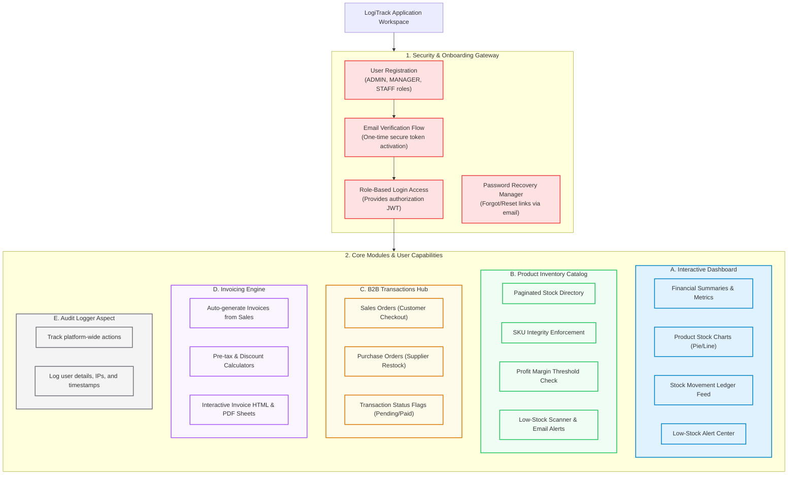

# 📦 LogiTrack — Enterprise Inventory Management System (IMS)

A production-grade, highly responsive full-stack inventory management, sales, purchase, and invoice orchestration system.

Spring Boot React PostgreSQL Swagger Mail-Service CORS-Wildcards Vercel Render

---

## 🚀 Overview
LogiTrack is a production-ready, enterprise-grade **Inventory Management System (IMS)** designed to streamline business workflows, automate stock tracking, and manage B2B transactions. Business administrators, managers, and staff can oversee real-time product stock, orchestrate client sales, trigger purchase restocking from suppliers, generate automated HTML/PDF invoices, track actions via platform audit logs, and receive auto-triggered notifications when stock levels run low.

Built with a performance-first architecture, the platform includes stateless JWT authentication, secure API endpoints, dynamic CORS origin handling, transactional database consistency, and fully automated deployment configurations for cloud deployment.

---

## ✨ Key Features
- **Interactive Financial Dashboard**: Monitor real-time platform metrics, including total products, low-stock warnings, monthly sales volumes, category distributions, and real-time transaction ledgers.
- **Dynamic Product Catalog**: Manage inventory items with pagination, sorting, and fuzzy search queries. Enforces SKU uniqueness and profit-margin validation controls (`Selling Price > Purchase Price`).
- **Orchestrated Sales & Restocking**: Track transactions from start to finish with structured sales orders (for customers) and purchase orders (for restocking from suppliers).
- **Automated Billing & Invoice Engine**: Instantly generate clean, professional invoices from completed sales orders, complete with subtotal, tax, and discount calculations.
- **Role-Based Security Guards**: Method-level security restrictions ensure that managerial operations (e.g. viewing audit logs, deleting products) are locked to matching users (`ADMIN`, `MANAGER`, `STAFF`).
- **Platform Audit Logging**: Log actions like log-ins, registrations, and transactions to audit trails, ensuring high visibility and compliance.
- **Automatic Email Alerts**: Automatic dispatch of low-stock notification emails to administrative staff when a product's quantity falls below its reorder threshold.
- **Resilient Offline Fallback**: Client automatically switches into a frontend **Demo Mode** if the REST backend becomes unreachable, ensuring uninterrupted demonstration capabilities.

---

## 🏗 Application Features & Flow



### Key Architectural Concepts
- **Dynamic Env Routing**: Axios instance automatically checks host origins at runtime to target `http://localhost:8080` locally, or the Render production backend if running on Vercel preview/production links.
- **SPA Routing Engine**: Rewrite configurations configured inside `vercel.json` rewrite any client-side routes back to `index.html`, eliminating the dreaded "Vercel 404 on refresh" bug.
- **Soft SMTP Exception Recovery**: Backend handles SMTP exceptions gracefully. Registration and transaction flows remain successful in the UI even if the outbound mail port is blocked (logs warning instead of crashing).
- **Auto-Verify Mode**: Developer-friendly bypass flag (`AUTO_VERIFY_USERS=true`) to override email verification steps on cloud platforms (such as Render Free Tier) where SMTP ports are blocked.

---

## 🛠 Tech Stack
- **Frontend**: React 19, Vite, Axios, React Router, Material Symbols, Vanilla CSS
- **Backend**: Spring Boot 3.x, Spring Security, Spring Data JPA, Java Mail Sender, Springdoc OpenAPI/Swagger, Lombok
- **Database**: PostgreSQL (Neon Cloud / Local)
- **Infrastructure**: Vercel (Frontend), Render (Backend)

---

## 📸 Screenshots & UI Showcase

### 🏗 Application Features & Flow Map


### 🔐 User Onboarding & Auth
| Login Portal | Registration Portal |
| :---: | :---: |
|  |  |

### 📊 Real-Time Operations Console
| Main Dashboard | Analytics & Reports |
| :---: | :---: |
|  |  |

### 📦 Product & Inventory Catalog
| Product Inventory Directory | Stock Movement Ledger |
| :---: | :---: |
|  |  |

### 💼 Restocking & Procurement (B2B)
| Customer Sales Orders | Supplier Restock Purchases |
| :---: | :---: |
|  |  |

### 📑 Invoicing & Notifications
| Billing & Invoices List | HTML/PDF Invoice Sheet |
| :---: | :---: |
|  |  |

| Live System Banners & Notifications |
| :---: |
|  |

---

## 💻 Local Setup & Deployment
Want to run this project yourself? Follow the steps below:

### 1. Clone the Repository
```bash
git clone https://github.com/jayswalhimanshu74-cmd/Inventory-Managment-System.git
cd Inventory-Managment-System
```

### 2. Backend Configuration
Navigate to the backend directory, locate [application.properties](file:///d:/Projects/Internhip-project/IMS_backend/src/main/resources/application.properties), or create a `.env` file at the root of the project with the following:
```env
DB_URL=jdbc:postgresql://localhost:5432/your_database_name
DB_USERNAME=postgres
DB_PASSWORD=your_postgres_password
JWT_SECRET=your_secret_minimum_32_chars
MAIL_USERNAME=your_sender_email@gmail.com
MAIL_PASSWORD=your_gmail_app_password
AUTO_VERIFY_USERS=false
```

Run the Spring Boot application:
```bash
cd IMS_backend
./mvnw spring-boot:run
```
The backend API Swagger docs will be accessible at: `http://localhost:8080/swagger-ui.html`

### 3. Frontend Configuration
Navigate to the frontend folder, install dependencies, and run the React development server:
```bash
cd IMS_frontend
npm install
npm run dev
```
The React client runs locally at: `http://localhost:5173`

---

## 🔒 Security Features
Security is prioritized across all layers of the LogiTrack application architecture:
- **Stateless Session Control**: Stateless verification using encrypted JWT tokens passed via authorization headers.
- **Data Hashing**: BCrypt encryption protects user password hashes in the database.
- **Double-Layer Data Validation**: Request validation handled using Zod schemas on the frontend and `@Valid` Hibernate validation constraints on backend DTOs.
- **Protected Method Guards**: Method-level security restrictions ensure company-wide admin operations are locked to matching roles.

---

## 🔮 Future Improvements
- **Redis Cache Integration**: Upgrade from JPA database reads on dashboard statistics to a Redis caching tier for sub-millisecond response times.
- **AWS S3 File Storage**: Transition local product image uploads to cloud-hosted AWS S3 or Cloudflare R2 buckets.
- **AI Stock Forecasting**: Integrate simple AI analysis tools to forecast stock sales trends and predict restock schedules based on historical logs.

---

## 🤝 Contributing
Contributions, bug reports, and features are welcome! Feel free to open issues or file pull requests.

---

## 📄 License
This project is open-source and licensed under the MIT License.
